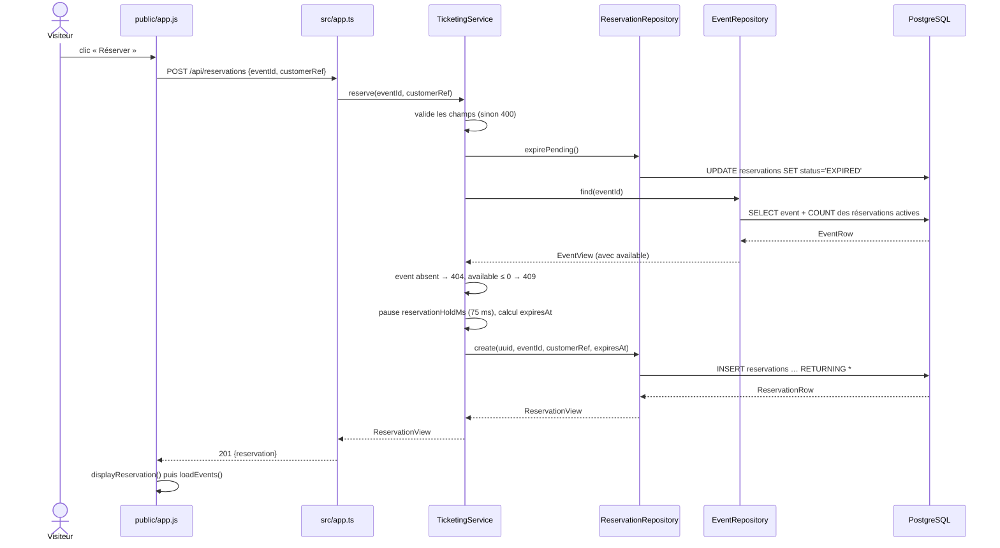

# TP 2 — Diagnostic N-Layer et règle « événement annulé »

> Règle à implémenter : un événement `CANCELLED` ne doit plus accepter de nouvelle réservation.
> Commit de départ : `73b24ca`.

---

## Étape 1 — Parcours « Réserver une place »



| #  | Couche                | Fichier, fonction                             | Ce qu'elle fait                                                                                                               |
|----|-----------------------|-----------------------------------------------|-------------------------------------------------------------------------------------------------------------------------------|
| 1  | Présentation          | `public/app.js` : `reserve()`                 | Lit `customerRef`, envoie `POST /api/reservations` avec `{eventId, customerRef}`.                                             |
| 2  | API HTTP              | `src/app.ts` : route `POST /api/reservations` | Normalise le corps avec `asRecord` (tout champ non chaîne devient `''`), appelle le service, renvoie **201**.                 |
| 3  | Service               | `TicketingService.reserve`                    | Valide les entrées (400 `INVALID_INPUT`) et enchaîne les étapes 4 à 9.                                                        |
| 4  | Accès données         | `ReservationRepository.expirePending`         | `UPDATE` qui passe en `EXPIRED` toutes les réservations `PENDING` échues. Effet de bord : une lecture déclenche une écriture. |
| 5  | Accès données         | `EventRepository.find`                        | `SELECT` de l'événement, avec `available` calculé en SQL. Convertit `EventRow` en `EventView`.                                |
| 6  | Service               | contrôles                                     | Événement absent : 404 `EVENT_NOT_FOUND`. Plus de place : 409 `SOLD_OUT`.                                                     |
| 7  | Service               | pause d'atelier                               | `sleep(reservationHoldMs)` agrandit la fenêtre de concurrence pour le test de concurrence.                                    |
| 8  | Service               | préparation                                   | Calcule `expiresAt` (maintenant + 15 min) et génère un `randomUUID()`.                                                        |
| 9  | Accès données         | `ReservationRepository.create`                | `INSERT` en `PENDING` avec `RETURNING *`. Convertit `ReservationRow` en `ReservationView`.                                    |
| 10 | Persistance           | tables `events`, `reservations`               | Contraintes `CHECK` sur les statuts et clé étrangère. Rien ne protège la capacité.                                            |
| 11 | API HTTP (retour)     | `setErrorHandler`                             | `AppError` devient `{ error: { code, message } }` avec son code HTTP. Toute autre erreur devient 503 `TECHNICAL_FAILURE`.     |
| 12 | Présentation (retour) | `displayReservation()`, `loadEvents()`        | Affiche l'état, puis recharge le catalogue (nouveau `GET /api/events`).                                                       |

Bilan : 3 requêtes SQL sans transaction, aucune intégration externe (le paiement n'intervient pas dans ce parcours).

| Objets métier                                                                                                        | Modèles techniques                                                                                                                                                                                |
|----------------------------------------------------------------------------------------------------------------------|---------------------------------------------------------------------------------------------------------------------------------------------------------------------------------------------------|
| Événement, Réservation, Places disponibles (calculées), Délai de rétention, Statuts, Client (réduit à `customerRef`) | `EventRow` / `ReservationRow`, corps JSON et `request`/`reply` Fastify, `asRecord`, `AppError` (code métier + code HTTP), enveloppes `{ reservation }` / `{ error }`, `Pool`, `reservationHoldMs` |

Cas ambigu : les `*View` portent les concepts métier, mais ce sont des objets de transport anémiques (données sans comportement, dates en chaînes ISO), utilisés tels quels de la base jusqu'à la réponse JSON.

---

## Étape 2 — Localiser la décision et préparer le changement

### 2.1 Où se prend la décision ?

**Q1.** Dans le parcours ci-dessus, quelles étapes **décident** (accepter ou refuser) ? Lesquelles ne font que **transporter** ou **stocker** des données ?

> Réponse : Le ticketing service prend les décisions, les repository et les app.ts ne font que transporter les données

**Q2.** L'information `status` de l'événement : dans quelle table est-elle stockée ? Le `SELECT` de `EventRepository.find` la lit-il ? Est-elle présente dans l'objet que reçoit la couche qui décide ?

> Réponse : dans la table Event, oui il estprésent dans l'objet envoyé au ticketing service.

**Q3.** Les décisions de refus existantes (`EVENT_NOT_FOUND`, `SOLD_OUT`) se trouvent dans quelle couche ? Qu'est-ce que ça t'indique pour la nouvelle règle ?

> Réponse : Toujours dans le ticketing service, il faudra intégrer la nouvelle règle métier dans cette couche là

### 2.2 Estimer le coût **avant** de coder

**Q4.** Complète ton estimation :

| Élément                           | Combien ? | Lesquels ? |
|-----------------------------------|-----------|------------|
| Méthodes de production à modifier | 1         | `TicketingService.reserve` |
| Fichiers de production à modifier | 1         | `src/services/TicketingService.ts` |
| Fichiers de test à modifier       | 1         | `tests/api.test.ts` |
| Nouveaux tests                    | 1         | réservation sur événement annulé |
| Nouvelles dépendances (npm)       | 0         | — |
| Migrations SQL                    | 0         | `status` existe déjà dans `events` et remonte dans `EventView` |

**Q5.** Faut-il une nouvelle couche, une nouvelle classe ou un nouveau type pour cette règle ? Justifie en une phrase.

> Réponse : Uniquement une nouvelle condition de validation dans la méthode de la classe, vu qu'il n'y a pas de domain, sinon je l'aurais mise dans le domain

### 2.3 Écrire le test de comportement (avant le code)

**Q6.** Décris le test en français :

- **Given** (situation de départ) : Un évènement qui a le status "CANCELLED"
- **When** (requête envoyée) : Lorsqu'une requête de réservation est acceptée
- **Then** (code HTTP, code d'erreur, format de la réponse) : 409 "CANCELLED_EVENT"
- **Et aussi** (ce qui ne doit **pas** s'être produit en base) : Il ne doit y avoir aucune écrire de réservation en base de donnée

**Q7.** Quel code HTTP choisis-tu ? Compare au moins deux possibilités (par exemple `409`, `410`, `422`) en t'appuyant sur les codes **déjà utilisés** par l'API (voir le README). Quel nom donnes-tu au code d'erreur ?

> Réponse : 409 conflict

**Q8.** Le jeu de données de démonstration (`db/seeds/001_demo.sql`) ne contient aucun événement annulé. Ouvre `tests/api.test.ts` : comment les tests existants préparent-ils la base avant chaque scénario ? Comment vas-tu créer ton événement `CANCELLED` sans modifier le seed ?

> Réponse : Une migration DB

**Q9.** Un second scénario intéressant : un événement **ouvert au moment où le client le consulte**, puis annulé avant qu'il ne réserve. Que doit répondre l'API ? En quoi ce test vérifie-t-il quelque chose de différent du premier ?

> Réponse : L'api doit répondre que l'évènement est cancelled, une vérification doit avoir lieu avant tout écriture DB, on peut imaginer une requete zerializable atomique qui vérifie le status avant tout écriture pour être certain.

**Q10.** Lance les tests avec ton (ou tes) nouveau(x) test(s), **avant** d'écrire la règle. Colle le résultat (nombre de succès et d'échecs, message d'échec principal).

```sh
docker compose --profile test run --build --rm test
```

```text
ℹ tests 9 — pass 7 — fail 2
✖ un événement annulé refuse toute nouvelle réservation
  AssertionError: 201 !== 409
✖ l’annulation survenue après la consultation est prise en compte à la réservation
  AssertionError: 201 !== 409
```

---

## Étape 3 — Implémenter la règle

**Q11.** Où places-tu la vérification dans la méthode, par rapport aux contrôles existants ? Que se passe-t-il si l'événement est **à la fois annulé et complet** : quelle erreur le client doit-il recevoir, et pourquoi ?

> Réponse : 409 CANCELED on vérifie d'abord le status puis s'il reste des places (opération moins couteuse)

**Q12.** Après l'implémentation, relance tous les tests. Colle le résultat.

```text
ℹ tests 9 — pass 9 — fail 0
```

**Q13.** Le contrat observable est-il préservé ? Vérifie :
- [x] format d'erreur `{ error: { code, message } }` inchangé
- [x] les codes HTTP existants n'ont pas changé
- [x] tous les tests d'origine passent toujours
- [x] aucune réservation ni tentative de paiement créée pour un événement annulé

**Q14.** Compare avec ton estimation de Q4 : qu'est-ce qui a réellement été touché ? Y a-t-il un écart ? Pourquoi ?

| Élément                | Estimé | Réel |
|------------------------|--------|------|
| Méthodes de production | 1      | 1 (`TicketingService.reserve`, 1 ligne) |
| Fichiers de production | 1      | 1 |
| Fichiers de test       | 1      | 1 (`tests/api.test.ts`) |
| Nouveaux tests         | 1      | 2 (+ 2 fonctions utilitaires `installEvent`, `countReservations`) |
| Dépendances            | 0      | 0 |
| Migrations             | 0      | 0 |

> Écart uniquement côté tests : un second scénario (annulation après consultation) prouve que la décision repose sur l'état relu au moment de la demande, et le seed ne contenant aucun événement annulé, il a fallu des fonctions utilitaires pour préparer les données. Le coût du changement est surtout dans la preuve, pas dans la production.

---

## Étape 4 — Justifier la couche et relever une dérive

### 4.1 Pourquoi cette couche ?

**Q15.** Explique pourquoi la règle **n'a pas sa place** dans chacun de ces endroits :

| Endroit                                                        | Pourquoi pas ? |
|----------------------------------------------------------------|----------------|
| Interface web (`public/app.js`), par exemple masquer le bouton | Contournable : n'importe quel client HTTP (curl, autre front) appelle l'API directement. Utile pour l'ergonomie, pas pour garantir la règle. |
| Route HTTP (`src/app.ts`)                                      | La route traduit HTTP ↔ appel de service. Un autre point d'entrée (job, autre route, test du service) ne passerait pas par elle, et elle n'a pas l'événement en main. |
| Repository (ajouter `AND status = 'OPEN'` dans le SQL)         | La règle serait cachée dans une requête : l'événement deviendrait « introuvable » (404) au lieu de « annulé » (409), et la décision métier se mélangerait au détail de stockage. |
| Base de données (contrainte ou trigger)                        | La règle porte sur deux tables (statut de l'événement au moment d'insérer une réservation) : trigger invisible depuis le code, difficile à tester, erreur SQL à retraduire en erreur métier. |

**Q16.** Résume en 2 ou 3 phrases pourquoi la couche que tu as choisie est la bonne.

> Réponse : C'est la couche qui requiert le minimum de modifications, garde l'application maintenable car la nouvele règles est centralisée avec les autres règles existantes.

### 4.2 Une dérive du N-Layer

Choisis **une** dérive visible dans le code parmi ces catégories : responsabilité excessive, mélange avec un détail technique, duplication, dépendance cachée.

**Q17.** Laquelle ? Donne le fichier et la ligne, cite le code concerné.

> Réponse : La partie controller a trop de responsabilité

> Précision : responsabilité excessive de `TicketingService` (`src/services/TicketingService.ts`), qui joue le rôle de contrôleur applicatif pour tout le système : `listEvents`, `getEvent`, `reserve`, `getReservation`, `checkout`, plus l'expiration (`await this.reservations.expirePending()` répété en tête de chaque méthode, l. 32, 37, 47, 59, 70). Il dépend directement de trois repositories PostgreSQL et du simulateur de paiement concret.

**Q18.** Quelle conséquence concrète cette dérive a-t-elle ? (Qu'est-ce qu'elle rend plus difficile à modifier, à tester ou à comprendre ?)

> Réponse : Toutes les évolutions (catalogue, réservation, paiement, expiration) convergent vers la même classe, donc les modifications se croisent et les risques de régression aussi. Pour tester une seule règle comme l'annulation, il faut instancier le service entier avec ses dépendances concrètes, donc une vraie base PostgreSQL. Et l'expiration dupliquée dans chaque méthode fait qu'une simple lecture déclenche une écriture, ce qui ne se voit pas dans les signatures.

**Q19.** Ta règle lit le statut de l'événement, puis la réservation est insérée un peu plus tard. Que se passe-t-il si l'événement est annulé **entre ces deux instants** ? Ta règle le garantit-elle ? (Inutile de corriger, il s'agit de nommer la limite.)

> Réponse : Non. La lecture (`events.find`) et l'insertion (`reservations.create`) sont deux requêtes indépendantes, sans transaction ni verrou. Une annulation qui survient entre les deux laisse passer une réservation sur un événement annulé. C'est la même fenêtre que celle de la survente (`test:challenge`). La garantir demanderait une opération atomique (transaction avec verrou sur la ligne de l'événement, ou insertion conditionnelle), ce qui sort du périmètre de ce TP.

---

## Étape 5 — Ce qui reste difficile

**Q20.** Peut-on tester ta règle **sans** démarrer PostgreSQL ni Fastify ? Pourquoi ? Qu'est-ce qu'il faudrait changer pour le permettre ?

> Réponse : Non on a besoin d'accéder aux données pour tester le controller. Il faudrait implémenter une partie domain avec des règles de validation propres qui puisse communiquer directement avec une interface pour des tests

**Q21.** Quelles responsabilités différentes `TicketingService` porte-t-il ? Liste-les. Combien de raisons différentes a-t-on de modifier cette classe ?

> Réponse : Repo

> Complément, responsabilités de `TicketingService` :
> 1. Validation des entrées (identifiants, `customerRef`, scénario de paiement)
> 2. Catalogue : lister et consulter les événements
> 3. Réservation : contrôles (existence, annulation, capacité), calcul de l'échéance
> 4. Expiration des réservations en attente (déclenchée à chaque appel)
> 5. Paiement : création des tentatives, appel du simulateur, transitions d'état
> 6. Traduction des refus en erreurs HTTP (`AppError` avec code 400/404/409/410)
>
> Soit au moins 5 à 6 raisons différentes de modifier la même classe.

**Q22.** Au TP 3, on ajoutera une capacité autour des **utilisateurs** (aujourd'hui, le client n'est qu'une chaîne `customerRef`). Quels fichiers, tables et méthodes seraient touchés ? Qu'est-ce qui te fait penser que ce sera coûteux (ou non) dans l'architecture actuelle ?

> Réponse :
> - **Base** : nouvelle table `users`, migration pour relier `reservations` à un utilisateur (remplacer ou compléter `customer_ref`).
> - **Types** : `ReservationView` (et probablement un nouveau `UserView`) dans `src/types.ts`, partagé par toutes les couches.
> - **Accès données** : nouveau `UserRepository`, modification de `ReservationRepository.create` et de son mapping `toView`.
> - **Service** : `TicketingService.reserve` (vérifier l'utilisateur), probablement de nouvelles méthodes (inscription, consultation de ses réservations), et le constructeur reçoit une dépendance de plus.
> - **HTTP** : nouvelles routes et câblage dans `buildApp` (`src/app.ts`), éventuellement identification de l'utilisateur à chaque requête.
> - **Interface** : le champ `customer-ref` de `public/app.js`.
> - **Tests** : tous les tests envoient `customerRef` dans leur payload.
>
> Coûteux : `customerRef` traverse toutes les couches de l'interface jusqu'à la table, les `*View` sont partagés par toutes les couches, et la nouvelle capacité atterrira elle aussi dans `TicketingService` déjà surchargé.

**Q23.** En une phrase : qu'est-ce que le N-Layer rend **facile** dans ce projet, et qu'est-ce qu'il rend **difficile** ?

> Réponse : Il rend facile de suivre un parcours et de savoir où ajouter une règle (ici, une ligne dans le service), mais difficile de tester une règle isolément (dépendances concrètes à PostgreSQL) et d'ajouter une capacité sans grossir encore une classe service centrale.

---

## Trace d'usage de l'IA

(voir `docs/usage-ia.md` pour ce qui est attendu)

> Ce qui a été proposé, ce qui a été retenu, comment ça a été vérifié, limites détectées :
> - **Proposé** : reformulation de la consigne, tracé du parcours « réserver », questions guidées, puis écriture des deux tests et de la règle (contrôle de `event.status` dans `TicketingService.reserve`, avant `SOLD_OUT`).
> - **Retenu** : le contrôle local dans le service, le code `409 EVENT_CANCELLED`, la préparation des données de test par `pool.query` plutôt que par migration.
> - **Vérifié** : tests lancés avant la règle (7 succès, 2 échecs `201 !== 409`), puis après (9 succès, 0 échec).
> - **Limite détectée** : une validation applicative ne garantit pas l'atomicité ; une annulation entre la lecture et l'insertion n'est pas couverte (voir Q19).
